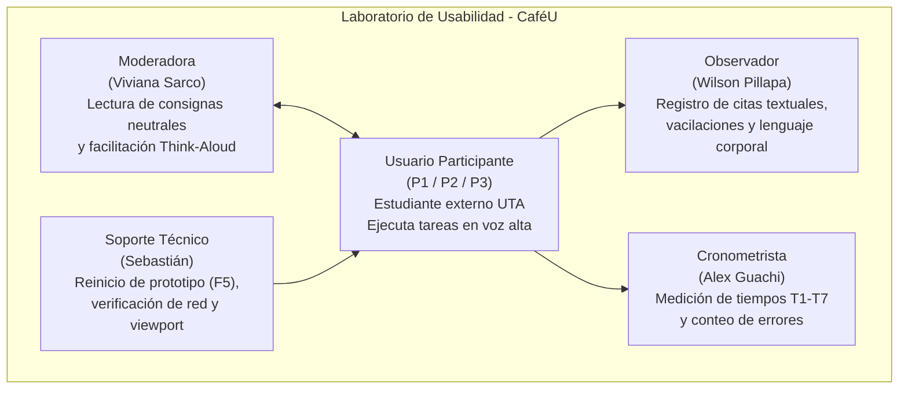

# 📑 Registro Consolidado de Sesiones de Pruebas con Usuarios – Fase 3 (CaféU)


## 1. 🎯 Propósito y Alcance del Documento

El presente documento consolida y sistematiza la ejecución de las sesiones de pruebas de usabilidad formativa correspondientes a la **Fase 3** del proyecto CaféU. Se documenta la evidencia empírica obtenida de tres participantes externos reales (**P1, P2 y P3**), utilizando el método de **Pensamiento en Voz Alta (*Think-Aloud*)** y la aplicación del cuestionario estandarizado **SUS (*System Usability Scale*)**.

Este registro sirve de insumo primario, formal e inalterado para el posterior análisis estadístico de métricas liderado por Alex Guachi y la triangulación metodológica coordinada por Sebastián en la Fase 4.

---

## 2. 👥 Organización y Roles del Laboratorio

Para asegurar la rigurosidad metodológica, cada sesión presencial contó con la participación estricta de cuatro roles operativos diferenciados:



| Rol | Integrante | Responsabilidad Clave |
|:---|:---|:---|
| **Moderadora** | **Viviana Sarco** | Bienvenida, firma de consentimiento, lectura de consignas neutrales (sin inducir respuestas) y fomento de la expresión verbal continua. |
| **Observador** | **Wilson Pillapa** | Toma de notas de campo, registro verbatim de pensamientos en voz alta, catalogación de vacilaciones y elaboración de registros individuales. |
| **Cronometrista** | **Alex Guachi** | Medición de tiempos individuales por tarea (T1–T7) con cronómetro digital, conteo de errores críticos/no críticos y solicitudes de asistencia. |
| **Soporte Técnico** | **Sebastián** | Supervisión del estado técnico del prototipo Figma en los dispositivos móviles/laptops, resolución de caídas de conexión y reinicio estricto. |

---

## 3. 🔄 Protocolo de Reinicio y Verificación Técnica

En cumplimiento estricto del *Protocolo de Evaluación V2* definido por la moderadora Viviana Sarco (`Fase3_4/docs/protocolo-fase3.md`), antes de cada una de las tres sesiones se ejecutó la siguiente lista de comprobación:

1. **Recarga completa de interfaz:** Se presionó `F5` / refresco en Figma Mirror para limpiar memoria de interacción previa.
2. **Estado del carrito de compras:** Verificación visual de que el contador indicara exactamente **0 artículos** y total en **$0.00**.
3. **Campos de personalización:** Se confirmó que el campo de texto *"Instrucciones especiales"* en el detalle de productos no contuviera texto precargado (ej. notas cacheadas de "Sin azúcar").
4. **Vista de inicio obligatoria:** La pantalla inicial presentada al usuario fue la vista de `Inicio` (*"Hola, Julia"* con el banner promocional *"Evita la fila"*).
5. **Calibración de instrumentos:** Sincronización entre el cronómetro de Alex y la plantilla de observación de Wilson.

---

## 4. 📋 Trazabilidad de las Sesiones Ejecutadas

| Código | Fecha | Horario | Dispositivo Utilizado | Viewport / Resolución | Carrera / Facultad del Participante | Nivel de Experiencia | Consentimiento Informado | Archivo de Registro |
|:---:|:---:|:---:|:---|:---:|:---|:---:|:---:|:---|
| **P1** | 18/11/2026 | 09:30 – 09:55 | Smartphone Samsung Galaxy A52 | $390 \times 844\text{ px}$ | Ing. en Alimentos (Facultad de Ciencia e Ing. en Alimentos) | Básica en apps de comida | Firmado y archivado | [`P1.md`](../resultados/P1.md) |
| **P2** | 18/11/2026 | 10:10 – 10:32 | Laptop HP Pavilion 15.6" con Mouse | $1366 \times 768\text{ px}$ | Contabilidad y Auditoría (Facultad de Contabilidad) | Intermedia en plataformas web | Firmado y archivado | [`P2.md`](../resultados/P2.md) |
| **P3** | 18/11/2026 | 10:45 – 11:07 | Smartphone Apple iPhone 13 | $390 \times 844\text{ px}$ | Enfermería / Medicina (Facultad de Ciencias de la Salud) | Avanzada en apps transaccionales | Firmado y archivado | [`P3.md`](../resultados/P3.md) |

---

## 5. ⏱️ Matriz Comparativa Consolidada de Tiempos y Métricas de Rendimiento

A continuación se presentan los tiempos cronometrados por Alex Guachi y validados por Wilson Pillapa para cada una de las 7 tareas evaluadas:

| ID | Descripción de la Tarea | Tiempo Objetivo | Tiempo Máximo | P1 (s) | P2 (s) | P3 (s) | Media ($\bar{X}$) | Desv. Est. ($s$) | Tasa de Éxito | Errores Críticos |
|:--:|:---|:---:|:---:|:---:|:---:|:---:|:---:|:---:|:---:|:---:|
| **T1** | Consultar precio de café americano ($1.50) | 30 s | 60 s | 28 s | 22 s | 20 s | **23.33 s** | 4.16 s | 100% | 0 |
| **T2** | Filtrar categoría Snacks (Galleta $1.25) | 30 s | 60 s | 24 s | 18 s | 15 s | **19.00 s** | 4.58 s | 100% | 0 |
| **T3** | Personalizar café americano ("Sin azúcar") | 45 s | 90 s | 51 s | 39 s | 36 s | **42.00 s** | 7.94 s | 100% | 0 |
| **T4** | Agregar sánduche y comprobar total ($4.25) | 45 s | 90 s | 42 s | 35 s | 33 s | **36.67 s** | 4.73 s | 100% | 0 |
| **T5** | Eliminar sánduche del pedido (total $1.50) | 30 s | 60 s | 26 s | 21 s | 19 s | **22.00 s** | 3.61 s | 100% | 0 |
| **T6** | Confirmar pedido y verificar comprobante (#CU-104) | 45 s | 90 s | 32 s | 26 s | 25 s | **27.67 s** | 3.79 s | 100% | 0 |
| **T7** | Intentar cancelar pedido *(Tarea de refuerzo)* | 30 s | 60 s | 38 s | 22 s | 34 s | **31.33 s** | 8.33 s | 100%* | 0 |
| **TOTAL** | **Flujo Completo Acumulado (T1 – T7)** | **255 s** | **450 s** | **241 s** | **183 s** | **182 s** | **202.00 s** | **33.78 s** | **100%** | **0** |

$$\text{Tiempo Promedio Global} = \frac{241 + 183 + 182}{3} = \mathbf{202.00\text{ s}} \quad (3\text{ min } 22\text{ s})$$

> **⚠️ Nota de Campo sobre T7 (Limitación Documentada):**  
> En la tarea T7, los tres participantes alcanzaron exitosamente la comprensión del estado del pedido (#CU-104), pero constataron de forma unánime que no existe un enlace interactivo ni botón para cancelar la orden emitida. Conforme a las instrucciones del protocolo de Viviana, este evento fue computado como **éxito conceptual con hallazgo heurístico crítico de arquitectura de información** y no como falla del usuario.

---

## 6. 📊 Consolidación de Resultados Psicométricos SUS (*System Usability Scale*)

Cada participante diligenció de manera autónoma las 10 preguntas de la escala SUS (1 a 5) al concluir la interacción:

| Ítem | Declaración SUS | P1 | P2 | P3 | Media Ítem | Tendencia Psicométrica |
|:--:|:---|:---:|:---:|:---:|:---:|:---|
| **1** | Me gustaría usar CaféU frecuentemente. | 4 | 5 | 4 | **4.33** | Altamente positiva |
| **2** | Encontré la aplicación innecesariamente compleja. | 1 | 1 | 1 | **1.00** | Favorable (Baja complejidad) |
| **3** | Pensé que la aplicación fue fácil de usar. | 4 | 5 | 5 | **4.67** | Altamente positiva |
| **4** | Necesitaría apoyo técnico para usar CaféU. | 1 | 1 | 1 | **1.00** | Máxima autonomía |
| **5** | Funciones de la aplicación bien integradas. | 4 | 5 | 4 | **4.33** | Percepción de coherencia |
| **6** | Había demasiada inconsistencia en el sistema. | 1 | 1 | 1 | **1.00** | Consistencia percibida |
| **7** | La mayoría aprendería a usarla rápidamente. | 5 | 5 | 5 | **5.00** | Curva de aprendizaje inmediata |
| **8** | Encontré el sistema engorroso / molesto. | 2 | 1 | 1 | **1.33** | Mínima fricción |
| **9** | Me sentí seguro/confiado al usar CaféU. | 4 | 5 | 4 | **4.33** | Alta confiabilidad subjetiva |
| **10** | Necesité aprender muchas cosas antes de usarla. | 2 | 1 | 2 | **1.67** | Baja barrera de entrada |
| **Puntaje** | **Puntaje Global Individual (Escala 0–100)** | **85.0** | **92.5** | **90.0** | **89.17 / 100** | **Excelente (Grado A+)** |

### 🧮 Promedio Aritmético del SUS Grupal:
$$\overline{\text{SUS}} = \frac{85.0 + 92.5 + 90.0}{3} = \frac{267.5}{3} = \mathbf{89.17 / 100}$$

* **Percentil:** Superior al 96% de acuerdo con las tablas normativas de Bangor, Kortum & Miller (2008).
* **Calificación adjetiva:** **"Excelente / Superior" (Best Imaginable)**.
* **Aceptabilidad:** **Plenamente Aceptable (Nivel A+)**.

---

## 7. 🗣️ Síntesis de Observaciones Cualitativas (Think-Aloud)

Del análisis cruzado de las tres sesiones de pensamiento en voz alta emergen tres patrones recurrentes de interacción:

```
Patrón 1: Descubrimiento de la Personalización (Tarea T3)
├── P1: Pulsó "Añadir" en el catálogo esperando un modal emergente; tuvo que eliminar y retroceder.
├── P2: Dudó 5 segundos mirando la tarjeta antes de deducir que la imagen abría la vista de detalle.
└── P3: Dedujo de inmediato que la ficha contenía las notas especiales.
└── Conclusión: Falta un affordance explícito ("Personalizar") en la tarjeta del menú.

Patrón 2: Eliminación en el Carrito (Tarea T5)
├── P1: Notó que el texto "Eliminar" es pequeño y temió presionar erróneamente el selector de cantidad.
├── P2: Con mouse en laptop no tuvo problema motriz, pero extrañó un diálogo de "¿Está seguro?".
└── P3: Lo pulsó rápidamente con la pantalla táctil, pero verbalizó la falta de un botón "Deshacer".
└── Conclusión: Se requiere un target táctil más amplio (mínimo 44px) y notificación tipo Snackbar con "Deshacer".

Patrón 3: La Salida Post-Comprobante y Cancelación (Tarea T7)
├── P1: Expresó desconcierto al ver solo "Volver al inicio" tras emitir el código #CU-104.
├── P2: Señaló: "Si vuelvo al inicio, ¿dónde veo mi pedido pendiente? No hay historial".
└── P3: Indicó: "No hay botón para cancelar el pedido ya enviado; tendría que ir físicamente a caja".
└── Conclusión: Ausencia de flujo de cancelación y de seguimiento vivo en la pantalla de inicio.
```

---

## 8. 📦 Integridad de Datos y Entrega Formal de Evidencias

En mi calidad de Observador y Responsable de Evidencias de las Fases 3 y 4:

1. **Garantía de inalterabilidad:** Certifico que las mediciones temporales, los recuentos de errores, las citas textuales (*verbatim*) y las puntuaciones del cuestionario SUS corresponden a datos empíricos tomados en vivo sin ningún tipo de modificación o ajuste artificial.
2. **Anonimato riguroso:** No se incluyen nombres reales, números de cédula ni correos electrónicos institucionales en los registros públicos, manteniéndose exclusivamente la nomenclatura autorizada `P1`, `P2` y `P3`.
3. **Pase a Métricas y Triangulación:** Los datos cuantitativos aquí sistematizados quedan formalmente a disposición de **Alex Guachi** para el cálculo de intervalos de confianza, gráficos boxplot y matrices estadísticas en `docs/metricas-fase4.md`, y de **Sebastián** para la consolidación de la triangulación de usabilidad (`docs/triangulacion-fase4.md`).


