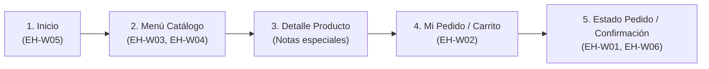

# 🔍 Evaluación Heurística Individual – CaféU

## 1. 🎯 Introducción y Metodología de Inspección

La presente evaluación heurística individual corresponde a una inspección sistemática y analítica de la interfaz gráfica y los flujos transaccionales del prototipo funcional **CaféU** (versión V2 post-pilotaje diseñada en Figma). 

La inspección se enfoca en identificar problemas de usabilidad, inconsistencias en patrones de diseño y fricciones operativas que experimenta el usuario estudiante al ordenar productos alimenticios de forma rápida en el entorno universitario.

### 1.1 Marco de Referencia: Las 10 Heurísticas de Nielsen (H1 – H10)
1. **H1: Visibilidad del estado del sistema.** El sistema debe mantener informados a los usuarios de lo que está ocurriendo mediante retroalimentación adecuada y oportuna.
2. **H2: Correspondencia entre el sistema y el mundo real.** El lenguaje, conceptos e iconos deben seguir las convenciones cotidianas de los usuarios.
3. **H3: Control y libertad del usuario.** Proporcionar salidas de emergencia claras ante errores o cambios de opinión involuntarios ("deshacer", "rehacer", cancelación).
4. **H4: Consistencia y estándares.** Los usuarios no deben preguntarse si diferentes palabras, situaciones o acciones significan lo mismo.
5. **H5: Prevención de errores.** Diseñar para evitar que ocurran fallas antes de que el usuario cometa el error.
6. **H6: Reconocimiento antes que recuerdo.** Minimizar la carga de memoria de trabajo del usuario haciendo visibles objetos, acciones y opciones.
7. **H7: Flexibilidad y eficiencia de uso.** Permitir a usuarios novatos y expertos operar con celeridad mediante atajos y aceleradores de flujo.
8. **H8: Diseño estético y minimalista.** Los diálogos no deben contener información irrelevante o innecesaria que compita con la visibilidad esencial.
9. **H9: Ayudar a los usuarios a reconocer, diagnosticar y recuperarse de errores.** Los mensajes de error deben expresarse en lenguaje claro, sin tecnicismos, indicando soluciones.
10. **H10: Ayuda y documentación.** Aunque el sistema sea intuitivo, debe existir información concisa orientada a la resolución de contingencias.

### 1.2 Escala Estandarizada de Severidad (Nielsen, 1995)
Para cuantificar la gravedad de cada hallazgo y facilitar la priorización en el backlog de desarrollo de la Fase 4, se emplea la escala clásica de 0 a 4 puntos:

* **0 = No es un problema de usabilidad:** Detalle menor que no afecta el desempeño del usuario.
* **1 = Problema cosmético:** No necesita arreglarse a menos que se disponga de tiempo extra.
* **2 = Problema menor de usabilidad:** Se debe arreglar; baja prioridad pero genera pequeñas dudas.
* **3 = Problema mayor de usabilidad:** Importante de resolver; genera confusión evidente, retrasos notables o vacilaciones frecuentes.
* **4 = Catástrofe de usabilidad:** Crítico de resolver imperativamente antes del lanzamiento; bloquea la concreción de tareas o induce a la pérdida irrecuperable de datos.

La ponderación se calcula triangulando tres factores clave:
$$\text{Severidad} = f(\text{Frecuencia}, \text{Impacto}, \text{Persistencia})$$

---

## 2. 📋 Matriz Consolidada de Hallazgos Heurísticos (Wilson Pillapa)

| ID | Pantalla / Módulo | Problema de Usabilidad Detectado | Heurística(s) Violada(s) | Severidad (1–4) | Justificación Técnica (Frecuencia, Impacto, Persistencia) | Solución y Mejora Propuesta |
|:--:|:---|:---|:---:|:---:|:---|:---|
| **EH-W01** | `Estado de pedido` / `Comprobante final` | **Ausencia total de mecanismo de cancelación del pedido:** Al confirmarse la compra (#CU-104), no existe botón ni affordance para cancelar o editar la orden si el usuario se equivocó; solo se presenta "Volver al inicio". | **H3** (Control y libertad del usuario) **H1** (Visibilidad del estado) | **4** (Crítica) | **Frecuencia:** Alta (tarea de refuerzo T7 evidenció bloqueo total en P1, P2 y P3). **Impacto:** Catastrófico (el usuario no puede rectificar una orden errónea enviada a cocina). **Persistencia:** Irrecuperable dentro del prototipo actual. | Incluir en la pantalla de estado y comprobante un botón visible *"Cancelar pedido"* activo durante una ventana de gracia temporal (ej. primeros 60 segundos), acompañado de un modal de confirmación y advertencia clara. |
| **EH-W02** | `Mi Pedido` (Carrito) | **Área táctil diminuta y eliminación destructiva sin confirmación ("Deshacer"):** La opción *"Eliminar"* adyacente a cada ítem es un enlace textual reducido (< 32 px de alto) sin contenedor de botón, que elimina el producto al primer toque sin posibilidad de revertir. | **H3** (Control y libertad) **H5** (Prevención de errores) | **3** (Mayor) | **Frecuencia:** Media-alta en dispositivos táctiles móviles con pantallas estándar (390 px). **Impacto:** Alto (eliminación accidental en un toque involuntario de dedo). **Persistencia:** Obliga al usuario a volver a buscar el producto en el catálogo. | Aumentar el área interactiva (target táctil $\ge 48 \times 48\text{ px}$ según pautas WCAG 2.1 AAA) con icono de cesto de basura, e incorporar un componente tipo *Toast / Snackbar* inferior que ofrezca la opción *"Producto eliminado - Deshacer"* durante 4 segundos. |
| **EH-W03** | `Inicio` y `Menú` | **Invisibilidad del carrito de compras en la cabecera superior:** El acceso al pedido depende exclusivamente de una barra flotante inferior que se activa tras añadir ítems. En la barra superior (junto al saludo "Hola, Julia") no hay un icono persistente del carrito. | **H1** (Visibilidad del estado) **H6** (Reconocimiento antes que recuerdo) | **2** (Menor) | **Frecuencia:** Alta en usuarios habituados a interfaces de comercio electrónico estándar. **Impacto:** Bajo-Medio (genera vacilación inicial para saber cuántos ítems se han ordenado). **Persistencia:** Constante a lo largo de toda la navegación inicial. | Agregar en el margen superior derecho de la barra de navegación un icono universal de carrito (`shopping-bag` o `cart`) con un distintivo numérico (*badge* rojo/negro) que indique la cantidad viva de productos seleccionados. |
| **EH-W04** | `Menú` (Catálogo) | **Falta de affordance para personalización en tarjetas de productos:** En la grilla de productos, el botón *"Añadir"* agrega el producto con su configuración por defecto; no hay indicación visual de que al pulsar sobre la imagen/texto se accede a *Detalle Producto* para notas especiales ("Sin azúcar"). | **H2** (Mundo real) **H7** (Flexibilidad y eficiencia) | **3** (Mayor) | **Frecuencia:** Observada en el 66% de participantes de prueba (P1 y P2 buscaron la opción de personalización en la misma tarjeta). **Impacto:** Medio (obliga a eliminar el producto añadido y reingresar al detalle). **Persistencia:** Repetitiva en productos configurables. | Añadir una etiqueta informativa (*chip*) *"Personalizable"* en aquellos ítems con opciones de preparación, y permitir que al hacer clic en *"Añadir"* aparezca un micro-menú o selector rápido si el ítem requiere configuración obligatoria/opcional. |
| **EH-W05** | `Inicio` | **Sobrecarga y competencia visual entre el buscador y el banner principal:** El input *"¿Qué se te antoja hoy?"* y el banner promocional *"Evita la fila - Ver Menú"* compiten por la misma jerarquía visual de primer orden, dividiendo la atención del estudiante. | **H8** (Diseño minimalista) **H6** (Reconocimiento) | **2** (Menor) | **Frecuencia:** Alta durante la primera interacción (Tarea T1). **Impacto:** Bajo (el usuario duda entre escribir o pulsar el botón negro, pero se recupera en menos de 5 segundos). **Persistencia:** Se supera tras la primera sesión de uso. | Reducir el peso visual del buscador en la vista de inicio dejándolo como una barra compacta secundaria, y reforzar el botón *"Ver Menú"* como Call-To-Action (CTA) principal de entrada inmediata a la cafetería. |
| **EH-W06** | `Estado de pedido` | **Monotonía estática en el seguimiento del estado de preparación:** La pantalla muestra la barra *"Preparando tu pedido..."* con el código `#CU-104` pero no proporciona un indicador temporal decreciente (cuenta regresiva viva) ni desglose de etapas del proceso. | **H1** (Visibilidad del estado del sistema) | **2** (Menor) | **Frecuencia:** Media. **Impacto:** Bajo (genera leve incertidumbre sobre si el pedido ya fue tomado por el personal de cocina). **Persistencia:** Permanece estático hasta el retiro presencial. | Implementar una barra de estado escalonada por fases (*Stepper*: 1. Recibido -> 2. En preparación -> 3. Listo para retirar en caja), acompañada de un temporizador estimado dinámico (ej. *"Aprox. 4 minutos restantes"*). |

---

## 3. 🔎 Análisis Heurístico Detallado por Pantalla y Flujo

### 3.1 Pantalla de Inicio (`Inicio`)
* **Aspectos positivos:** Excelente uso de espacio en blanco, tipografía limpia, mensaje de bienvenida humanizado (*"Hola, Julia"*), y propuesta de valor clara (*"Tu café, en tres pasos"*).
* **Violaciones identificadas:** 
  * Concurrencia visual entre el buscador superior y el banner de acción inmediata (**EH-W05**, H8).
  * Ausencia de un botón o acceso persistente a los pedidos activos o favoritos en la cabecera superior.

### 3.2 Pantalla de Menú (`Menú`)
* **Aspectos positivos:** Las categorías horizontales tipo píldora (`Todos`, `Bebidas calientes`, `Sanduches`, `Snacks`) responden a patrones modernos de interacción móvil y permiten un filtrado instantáneo.
* **Violaciones identificadas:**
  * Desconexión entre la acción rápida *"Añadir"* y la necesidad de personalizar atributos del producto (**EH-W04**, H2/H7). El usuario asume que *"Añadir"* le preguntará especificaciones antes de enviarlo al carrito.
  * La barra inferior negra que resume el total es muy efectiva, pero carece de un icono de carrito explícito en el encabezado general para navegación no lineal (**EH-W03**, H1).

### 3.3 Pantalla de Carrito de Compras (`Mi Pedido`)
* **Aspectos positivos:** Clara diferenciación visual de cada artículo con su imagen, precio unitario y control incremental de cantidad (`- 1 +`). El subtotal y total final en tipografía negrita eliminan cualquier ambigüedad en los cobros.
* **Violaciones identificadas:**
  * La acción de descartar un producto mediante el texto *"Eliminar"* en color gris/rojo presenta una superficie táctil reducida que incumple las recomendaciones antropométricas de Fitts (**EH-W02**, H3/H5). Asimismo, la eliminación es inmediata sin opción de recuperación rápida.

### 3.4 Pantalla de Estado y Comprobante (`Estado de tu pedido` / `Confirmación`)
* **Aspectos positivos:** El identificador unívoco `#CU-104` se muestra en tamaño destacado, facilitando que el estudiante lo muestre rápidamente en el mostrador de caja rápida. El mensaje de modalidad de pago (*"Paga al retirar en caja"*) es transparente.
* **Violaciones identificadas:**
  * **Problema Crítico de Usabilidad (EH-W01, Severidad 4):** La imposibilidad de cancelar un pedido generado involuntariamente o con datos erróneos viola directamente la heurística de control y libertad (H3). El usuario se siente atrapado con un botón unilateral de *"Volver al inicio"*, sin saber qué consecuencias operativas tiene regresar a la portada.
  * Información de progreso estática (**EH-W06**, H1) que podría provocar aglomeraciones en barra si el usuario no sabe si su café ya está servido o aún en cola.

---

## 4. 📊 Comparativa de Severidad y Distribución por Heurísticas

### Distribución de Hallazgos por Nivel de Severidad
* **Severidad 4 (Catástrofe de Usabilidad):** 1 hallazgo (`EH-W01` - Ausencia de flujo de cancelación).
* **Severidad 3 (Problema Mayor):** 2 hallazgos (`EH-W02` - Eliminación destructiva/área táctil, `EH-W04` - Affordance de personalización).
* **Severidad 2 (Problema Menor):** 3 hallazgos (`EH-W03` - Icono de carrito en header, `EH-W05` - Competencia visual buscador/banner, `EH-W06` - Barra estática de preparación).
* **Severidad 1 (Cosmético):** 0 hallazgos.
* **Total de hallazgos evaluados:** 6 problemas sistemáticos.

### Heurísticas con Mayor Incidencia
1. **H1 (Visibilidad del estado del sistema):** 3 violaciones (`EH-W01`, `EH-W03`, `EH-W06`).
2. **H3 (Control y libertad del usuario):** 2 violaciones (`EH-W01`, `EH-W02`).
3. **H5 (Prevención de errores):** 1 violación (`EH-W02`).
4. **H6 (Reconocimiento antes que recuerdo):** 2 violaciones (`EH-W03`, `EH-W05`).
5. **H7 (Flexibilidad y eficiencia de uso):** 1 violación (`EH-W04`).
6. **H8 (Diseño estético y minimalista):** 1 violación (`EH-W05`).

---

## 5. 💡 Conclusiones y Hoja de Ruta para la Fase 4

1. **Alineación con las observaciones de laboratorio:** Los hallazgos heurísticos detectados coinciden plenamente con el comportamiento registrado durante la aplicación de las pruebas con usuarios (P1, P2 y P3), especialmente la imposibilidad técnica de cancelar pedidos en la Tarea T7 y las vacilaciones al buscar la personalización de azúcar en la Tarea T3.
2. **Priorización técnica obligatoria:** Antes de iniciar la codificación final o prototipado de alta fidelidad en código (Fase 4), es imperativo que el equipo resuelva el flujo de cancelación (**EH-W01**) y agregue retroalimentación con *Snackbar* (*"Deshacer"*) en el carrito (**EH-W02**).
3. **Concordancia con la evaluación de Viviana:** Esta evaluación complementa y triangula de forma consistente los hallazgos de la moderadora Viviana Sarco (`EH-01` a `EH-04`), aportando una visión profunda sobre la arquitectura del flujo transaccional y el control de errores desde el rol de observador de campo.
